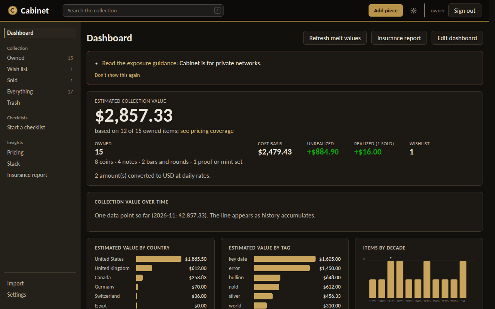
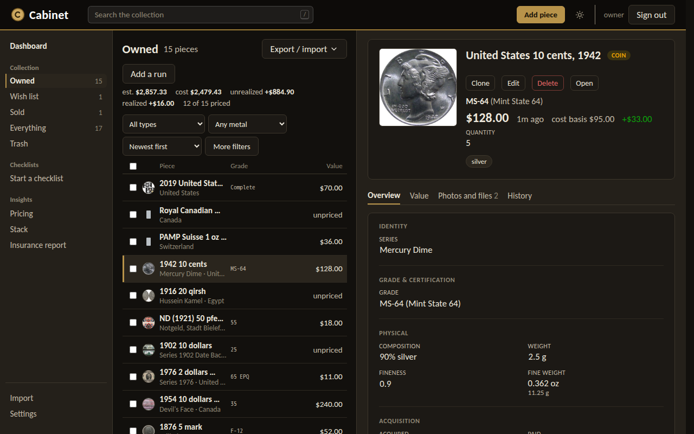
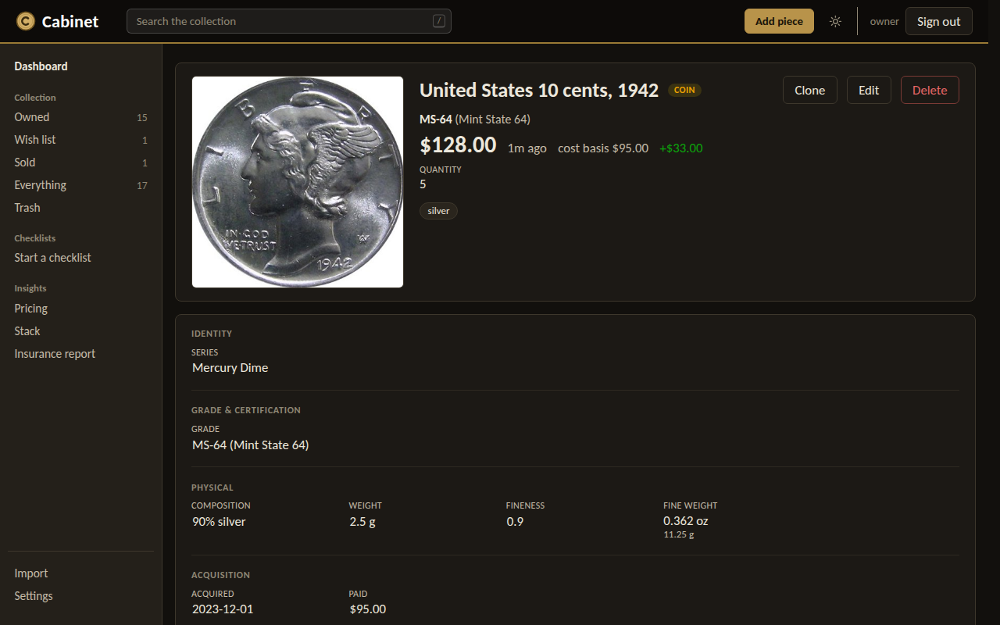
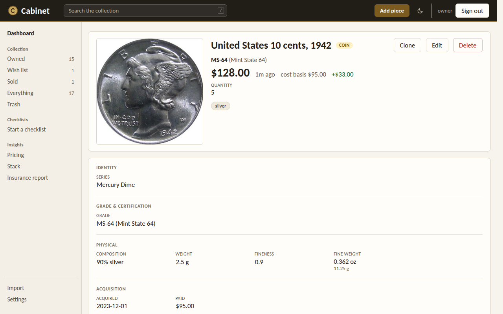

# Cabinet

**A self-hosted collection manager for coins, paper money, bullion, and proof and mint sets.**

[](https://github.com/jsaumer/cabinet-numismatics/actions/workflows/ci.yml)
[](LICENSE)


Cabinet catalogs your collection, keeps the photos and paperwork with each
piece, and tracks what it is worth over time from sources you can check. It
runs on your own machine as a small Docker stack: no account with anyone, no
subscription, and nothing about your collection leaves it.

It is for one collector who is comfortable running Docker on a home server
or NAS.

**Status:** v0.37.3, in use on its author's own collection. 1.0 will mean a
stable HTTP API; until then the API may still change.
[Changelog](CHANGELOG.md) · [Roadmap](docs/roadmap.md)

| | |
|---|---|
| [](docs/screenshots/dashboard-dark.png) | [](docs/screenshots/collection-dark.png) |
| [](docs/screenshots/item-detail-dark.png) | [](docs/screenshots/item-detail-light.png) |

Shown with the bundled demo collection. Dark is the default; a light mode
and four color themes are a click away. [More screenshots](docs/screenshots/).

## What it does

**Catalog every kind of piece**

- Coins, notes, bars and rounds, and proof or mint sets, each with the
  fields it actually has.
- Grades as the holder reads them (Sheldon and PMG scales, proof and
  specimen strikes, designations, details grades, CAC), cert numbers with a
  link to verify them, and PCGS population.
- Paper money in depth: serial numbers with fancy serials spotted for you
  (radars, repeaters, ladders, solids), signatures, Friedberg and Pick
  numbers, and National Bank Note fields.
- Undated pieces, dates as struck in eleven calendars, varieties, die axis,
  tags, sets, storage location, and up to 20 custom fields.
- A wish list with target prices, and checklists that fill themselves from
  what you own.

**Enter pieces quickly**

- Quick add: one box takes a name, a Numista number, or a PCGS cert number
  and fills the piece in.
- Add a run: tick the dates and mints you have of a type and get one item
  each.
- Import your Numista collection, Numista's export, an OpenNumismat file
  with its photos, or any spreadsheet, with a preview first.
- Duplicate warnings, bulk edit, editing in place, and a trash with restore.

**Keep photos and paperwork with the piece**

- Several photos per piece, from a file, a paste, a URL, or a camera, with
  crop, turn, and straighten in the browser.
- Every stored photo is saved without its metadata: no location, camera, or
  timestamp.
- Receipts, certificates, and invoices (PDF or image) attached to one piece
  or shared across a lot.

**Know what it is worth, and why**

- Melt value from live spot prices, Numista and PCGS prices through your own
  free API keys, a log of comparable sales with a median estimate, and
  values you type in yourself.
- Every estimate keeps its source, its inputs, and its history, so a value
  can be explained and charted over time.
- Totals in one currency at daily exchange rates, with gain or loss net of
  fees.
- A bullion stack: fine ounces by metal, cost per ounce, premium paid over
  spot, and spot-price alerts.
- Pricing reports: what has no value and why, what is stale, and where the
  sources disagree.

**See it and show it**

- A dashboard you arrange yourself from 32 widgets, an insurance report with
  photos and certs, and CSV and Excel export.
- Read-only share links to the collection, a set, or a checklist. Off by
  default, and never showing a cost or a storage location.

**Run it without worry**

- One admin account, scoped API tokens, and optional single sign-on (OpenID
  Connect, GitHub, or a gateway's signed header).
- Encrypted, verified backups on a schedule, and restore from inside the
  app with an automatic safety backup first.
- Alerts by webhook (ntfy, Discord, Slack, Gotify, n8n), an Uptime Kuma
  heartbeat, and Prometheus metrics.
- A REST API with an OpenAPI schema, and a layout that works on a phone.

Every field and option is in [docs/features.md](docs/features.md), with a
table of [how Cabinet compares](docs/features.md#how-cabinet-compares) with
OpenNumismat, CoinManage, and Numista.

## Know before you install

- **One user, private networks.** One admin account and one collection,
  meant for a home network, a homelab, or a VPN, not the open internet
  (see [Private networks only](#private-networks-only)).
- **Bring your own keys.** There is no bundled catalog or price guide. Melt
  value needs no key; Numista and PCGS lookups use each service's free API
  key and stay inside its limits.
- **amd64 images only** for now. There is no ARM build yet.
- **English only**, with the Sheldon and PMG grading scales.
- **Sized for a personal collection.** It is built and used at hundreds of
  pieces. At several thousand the lists stay quick, and the dashboard and
  reports take a few seconds.
- **Estimates are guidance, not appraisals.** For insurance or a sale, get
  a professional appraisal or a grading-service valuation.

## Quick start

You need Docker with Compose v2 on an amd64 machine. Cabinet uses about
200 MB of memory at idle.

```bash
git clone https://github.com/jsaumer/cabinet-numismatics.git
cd cabinet-numismatics
cp .env.example .env              # change DB_PASSWORD; the rest suits this machine
docker compose pull               # the published images
docker compose up -d --no-build
```

1. Open http://localhost/. Until it is claimed, Cabinet serves nothing but
   its setup page.
2. Read the one-time setup code from the log, then enter it with the
   username and password you want. That account is the only one.

   ```bash
   docker compose logs backend | grep "setup code"
   ```

3. In Settings → Backups, save your backup key and switch on scheduled
   backups. Every archive is encrypted with that key, and a lost key has no
   recovery.

**Running it on a server?** The sample `.env` answers only at
`http://localhost`, and any other address gets no response. Set
`PUBLIC_ORIGINS` to the exact address you will type, for example
`https://cabinet.home.example`, remove `AUTH_INSECURE_HTTP`, and put Cabinet
behind your reverse proxy with HTTPS. The
[deployment guide](docs/deployment.md) covers that, single sign-on, storage
on a NAS, and a [Swarm stack file](deploy/docker-stack.yaml).

**Building from source?** `docker compose up --build` does it all; no Node
or Python is needed on the host.

**Want something to look at first?** Create a write token in Settings →
Account, then load 17 demo pieces with photos:

```bash
python scripts/seed_demo.py --token cabinet_...
```

**Upgrading:** run the `pull` and `up` lines again, or pin a release with
`TAG=0.37.3` in `.env`. The backend migrates the database itself on startup,
and Settings → About shows the version and whether the schema is current.

## Private networks only

<!-- exposure-warning: copied verbatim; the source is docs/deployment.md -->
Cabinet is designed for private networks (a home LAN, a homelab, or a VPN
you control), not the open internet. Do not expose it directly to the
internet, even behind TLS, single sign-on, or an authenticating gateway;
reach it from outside through your own network's remote access instead,
such as a VPN (WireGuard, Tailscale, or your router's own) or an
identity-aware tunnel that terminates before Cabinet. Cabinet has one
admin account and, by design, a password sign-in path with a single
factor, so that a provider outage or a lost phone can never lock you out;
exposing any self-hosted service that holds personal records invites
automated credential guessing and vulnerability scanning within hours of
the port opening. The project cannot see or control how Cabinet is
deployed and takes no responsibility for an exposed instance. If you
deploy it this way regardless, at minimum use TLS, single sign-on with
multi-factor authentication enforced at the provider, an authenticating
gateway in front, the alert webhook switched on, and a password no human
has memorized.
<!-- exposure-warning: copied verbatim; the source is docs/deployment.md -->

If you turn sharing on, exempt `/s/`, `/api/share/`, and `/robots.txt`
from any gateway kept in front, or a forward-auth proxy blocks your own
share links too. See [docs/deployment.md](docs/deployment.md#sharing-and-the-forward-auth-exemption).

## Configuration

Deployment settings are environment variables in `.env`. These are the ones
most installs touch; [all of them](docs/architecture.md#configuration) are
in the architecture guide.

| Variable | Purpose |
|---|---|
| `PUBLIC_ORIGINS` | Required. The exact address or addresses browsers use to reach Cabinet, comma-separated. Nothing starts without it, and no other address is answered |
| `DB_USER`, `DB_PASSWORD`, `DB_NAME` | The Postgres account and database |
| `CABINET_PORT` | The port the proxy publishes (default `80`) |
| `TAG` | The image version to run (default `latest`) |
| `SETUP_CODE` or `SETUP_CODE_FILE` | Your own one-time setup code. Unset, one is generated and logged |
| `BACKUP_KEY_FILE` or `BACKUP_KEY` | Your own backup key. Unset, one is generated onto a volume; save a copy either way |
| `SECRET_KEY` | The key that encrypts stored API credentials. Unset, one is generated onto a private volume |
| `PUID`, `PGID` | The unprivileged user the backend runs as (default `1000`:`1000`) |

Everything else is set in the app: display currency, price-source keys,
refresh schedules, backups, alerts, sharing, and sign-in providers.

**What Cabinet contacts.** Metal spot prices (gold-api.com), daily exchange
rates (frankfurter.dev), and a public currency dataset for the spot price
on a past purchase day. Numista and PCGS are contacted only after you save
a key and switch them on. A lookup sends a catalog or cert number and
nothing about your collection. Anything else is something you set up
yourself: an alert webhook, a sign-in provider, or a photo fetched from a
URL you paste.

## Backup and restore

Settings → Backups downloads an encrypted archive of the database, photos,
and documents, schedules them with retention, and restores one after taking
a safety backup first. Keep a copy of the backup key outside Cabinet;
without it nobody can open an archive. When the app itself won't start:

```bash
./scripts/backup.sh
./scripts/restore.sh cabinet-backup-20260914-031500.zip.age
```

See [docs/backup-restore.md](docs/backup-restore.md), and copy your backups
off the machine.

## Documentation

- **Running it:** [Deployment](docs/deployment.md) ·
  [Backup and restore](docs/backup-restore.md) ·
  [Monitoring](docs/monitoring.md) · [Security](docs/security.md)
- **Using it:** [Features](docs/features.md) ·
  [Price sources](docs/price-sources.md)
- **Building on it:** [API](docs/api.md) ·
  [Architecture](docs/architecture.md) · [Data model](docs/data-model.md) ·
  [Roadmap](docs/roadmap.md) · [Changelog](CHANGELOG.md)
- **Working on it:** [Contributing](CONTRIBUTING.md) ·
  [Implementation notes](docs/implementation-notes.md) ·
  [Backend](backend/README.md) · [Frontend](frontend/README.md)

## How Cabinet is built and checked

Cabinet is three containers: nginx (the interface and photos), a FastAPI
backend, and PostgreSQL. It is written by one maintainer working with
[Claude Code](docs/claude-code.md), an AI coding assistant, and it is
checked like this:

- Since sign-in arrived, each large feature is specified, reviewed, and
  approved before any code ([docs/specs](docs/specs/)). Sign-in, sharing,
  and single sign-on each went through separate security reviews, with the
  findings and fixes recorded in the spec.
- About 1,360 backend tests and a browser test suite run on every change.
- CI builds the whole stack each time, restores a backup into it, and
  upgrades a database from an older release.
- Dependencies are hash-pinned, audited, and the images scanned on every
  change and weekly.
- Single sign-on was validated on a live instance against real identity
  providers and a vulnerability scanner
  ([docs/live-validation.md](docs/live-validation.md)).

Found a security problem? Please report it privately:
[SECURITY.md](SECURITY.md).

## Contributing and license

Issues and pull requests are welcome; [CONTRIBUTING.md](CONTRIBUTING.md) has
the setup and what is in scope. Cabinet stays deliberately small, and the
[roadmap](docs/roadmap.md) records what was cut and why.

[MIT](LICENSE) © 2026 Jayson Saumer. Cabinet is not affiliated with or
endorsed by Numista, PCGS, NGC, or PMG.
